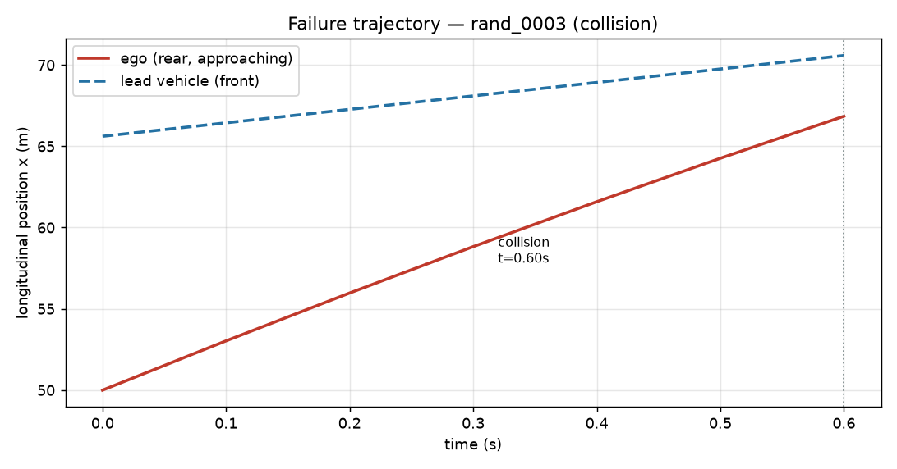
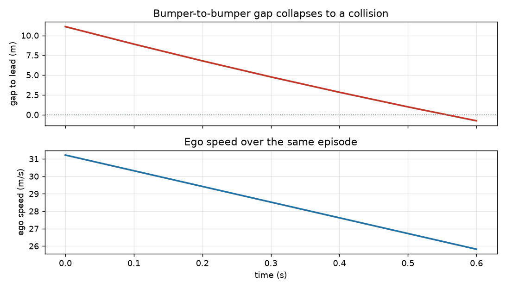
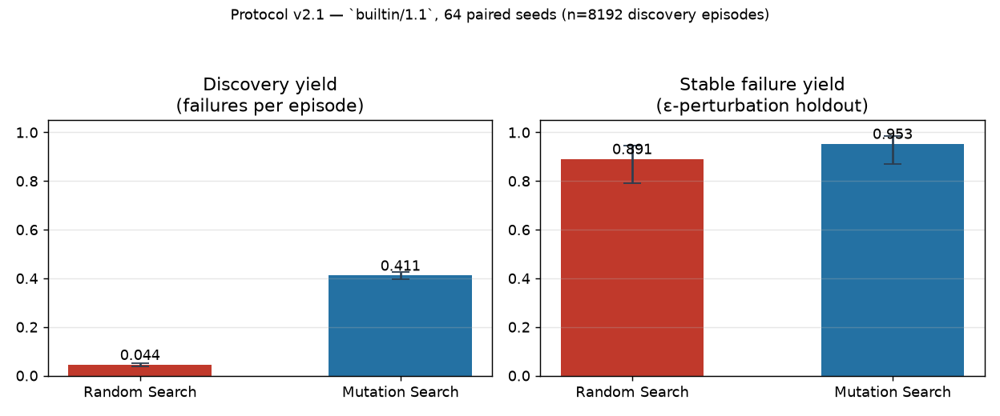
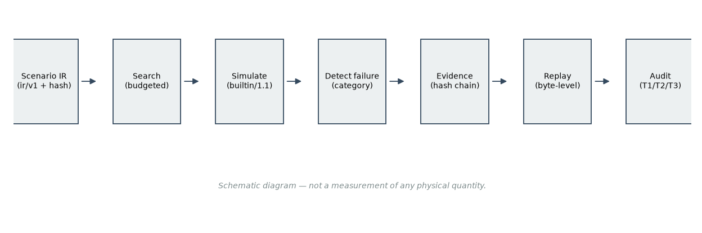

# DriveEvidenceLab

**Reproducible Driving Failure Discovery & Evidence Toolkit**

*Simulation-only research toolkit — not a safety-certified system, and it makes no real-road claims.*

DriveEvidenceLab discovers failure scenarios in driving simulation, archives
them as **tamper-evident evidence**, and then asks the question most benchmarks
skip: **is the discovered failure actually reproducible, or was it a
knife-edge artifact of one exact configuration?**

[中文说明](README.zh-CN.md) · [API](docs/API.md) · [Architecture](docs/ARCHITECTURE.md) · [Limitations](docs/LIMITATIONS.md) · [Quality audit](docs/OPEN_SOURCE_QUALITY_AUDIT.md)

**Project status**

| | |
|---|---|
| Version | `0.2.0` (research preview) |
| Python | 3.10 – 3.13 |
| License | Apache-2.0 |
| Tests | 156 passing locally (`python -m unittest discover -s tests`) — CI badge pending first public repository |
| Simulation backend | builtin kinematic (`builtin/1.1`); CommonRoad exchange verified; CARLA not implemented |

---

## Why DriveEvidenceLab?

Autonomous-driving simulation studies are easy to run and hard to trust. A
"crash" produced by a search script is only meaningful if someone else can
re-run the exact scenario, inspect the evidence, and confirm nothing was
edited afterwards. DriveEvidenceLab is built around that chain of trust:

- **Systematic failure discovery** — two budget-matched search strategies
  (random prior vs archive-based mutation) explore a scenario space and
  nominate failures under a shared accounting rule.
- **Strict replay** — every archived failure can be re-run bit-for-bit:
  same scenario hash, same seed, same planner, same result.
- **Verifiable evidence** — an append-only SHA-256 hash-chained ledger plus a
  whole-run manifest make tampering detectable, not just discouraged.
- **Python SDK integration** — typed result objects (`EpisodeResult`,
  `SearchReport`) that drop straight into pandas, pytest, or your own pipeline.
- **Adapter interface** — one scenario IR (`ir/v1`) and one adapter protocol;
  a builtin kinematic backend today, more backends without rewriting your
  analysis code.

## Features

| Capability | Status |
|---|---|
| Canonical scenario IR (`ir/v1`) with deterministic hashing | **Supported** |
| RandomSearch / MutationSearch with shared budget accounting | **Supported** |
| ε-perturbation stability holdout | **Supported** |
| Hash-chained ledger + manifest + byte-level replay | **Supported** |
| Markdown / HTML run reports | **Supported** |
| CLI (7 subcommands) + Python SDK | **Supported** |
| HighwayEnv adapter | **Experimental** — runs, not pooled with builtin results |
| CommonRoad XML exchange | **Partial** — judging layer only, no third-party dynamics |
| CARLA adapter | **Not implemented** |
| Web UI / GUI | **Not implemented** |

## Quick Start

```bash
# 1. install (Python 3.10–3.13)
python -m venv .venv && source .venv/bin/activate      # Windows: .venv\Scripts\activate
pip install driveevidence                              # from the release wheel, or:
# pip install -e ".[sim,dev]"                          # from a source checkout

# 2. sanity-check the environment
driveevidence doctor

# 3. run a real falsification search with archived evidence
#    (seed 2101 deterministically yields failures; 2100 is a known zero-candidate seed)
driveevidence search --method mutation --adapter builtin --budget 64 --seed 2101 \
                     --run-id my_search --out runs

# 4. audit the evidence (ledger hash chain + manifest)
driveevidence audit --run runs/my_search

# 5. replay an archived failure bit-for-bit
driveevidence replay --run runs/my_search --seq 1 --adapter builtin

# 6. generate a report
driveevidence report --run runs/my_search --format html --out runs/my_search/report.html
```

Prefer a packaged example with a pre-built evidence run?

```bash
driveevidence audit  --run examples/case_pack/run          # verify shipped evidence
driveevidence replay --run examples/case_pack/run --seq 1 --adapter builtin
python scripts/build_case_pack.py --check                   # regenerate & compare
```

## Python SDK

A real end-to-end session — load a scenario, run an episode, search for
failures, compute a confidence interval (from
[`examples/minimal_sdk_example.py`](examples/minimal_sdk_example.py)):

```python
from driveevidence.scenario import ScenarioIR
from driveevidence.search import Budget, RandomSearch
from driveevidence.sim import create_adapter, list_adapters
from driveevidence.stats import wilson_ci

scenario = ScenarioIR.from_dict({...})          # canonical ir/v1 JSON
adapter  = create_adapter("builtin")            # or "highwayenv" / "commonroad"

result = adapter.run_episode(scenario, seed=123, planner_name="safe_follow")
print(result.failure_category, result.metrics)  # typed, hash-stamped result

report  = RandomSearch().search(adapter=adapter, budget=Budget(max_episodes=32),
                                master_seed=42)
lo, hi  = wilson_ci(len(report.candidates), report.budget_snapshot["launched"])
```

More runnable demos:

| Demo | File | What it shows |
|---|---|---|
| SDK minimum | [`examples/minimal_sdk_example.py`](examples/minimal_sdk_example.py) | scenario → episode → search → Wilson CI |
| Failure discovery | [`examples/failure_discovery_demo.py`](examples/failure_discovery_demo.py) | fixed-seed search, category summary, zero-candidate handling |
| Replay & evidence | [`examples/replay_evidence_demo.py`](examples/replay_evidence_demo.py) | archive → audit → bit-exact replay → manifest check |
| Programmatic integration | [`examples/programmatic_integration_demo.py`](examples/programmatic_integration_demo.py) | typed results → flat dicts → your analysis stack |

## CLI

Seven subcommands, one evidence format:

```text
driveevidence doctor    environment diagnostics (install mode, adapters, optional deps)
driveevidence sample    write a sample scenario JSON
driveevidence run       run one episode and archive the evidence
driveevidence search    run a budgeted falsification search
driveevidence audit     verify ledger hash chain + manifest hashes
driveevidence replay    re-run an archived episode exactly
driveevidence report    Markdown / HTML report from a run
```

## What the results look like

Real outputs from archived runs (generated by
[`scripts/make_figures.py`](scripts/make_figures.py) — every number traces to
`runs/formal_experiment_v2p1/`, no hand-tuned values):









## Results & Evidence

Formal protocol v2.1 (frozen pre-registration), backend `builtin/1.1`,
8192 discovery episodes + 384 ε-perturbation holdout episodes:

| Method | Discovery yield [Wilson 95%] | Tested | Stable | Stable yield [Wilson 95%] |
|---|---|---|---|---|
| random | 0.0444 [0.0385, 0.0512] | 64 | 57 | **0.8906 [0.7910, 0.9460]** |
| mutation | 0.4114 [0.3964, 0.4265] | 64 | 61 | **0.9531 [0.8710, 0.9839]** |

| Hypothesis | Result |
|---|---|
| H1 — random-search stable yield > 0.1 | **supported** (Wilson lower bound 0.791) |
| H2 — stable-yield difference mutation vs random | **not detected** (Δ=+0.0625, Newcombe 95% CI [−0.0365, +0.1668] crosses 0) |
| H3 — mutation discovery yield higher | **supported** (Δ=+0.3669, paired bootstrap 95% CI [0.3218, 0.4124]) |

Read this as: *mutation finds far more failures per episode, but the failures
both methods find are about equally robust to perturbation.* H2 is "not
detected", **not** "the methods are equivalent".

Verify every number yourself, without trusting us:

```bash
python scripts/verify_evidence_bundle.py
```

This walks the hash chain, checks 773 files against the manifest, and
**recomputes** the headline statistics from raw artifacts.

### A retraction you should know about

Protocol v1 reported stable yields of 0.111 vs 0.010 favouring random. That
result was **withdrawn**: the audit found the simulator created an RNG and
never used it, making all 1716 candidates bit-identical across their three
"independent" holdout seeds — 100 % stability was a tautology. The retraction,
the corrected protocol (v2/v2.1) and the full audit are in
[`docs/SCIENTIFIC_AUDIT.zh-CN.md`](docs/SCIENTIFIC_AUDIT.zh-CN.md). Original
v1 artifacts remain in the evidence bundle, unmodified.

## Documentation

| Document | Content |
|---|---|
| [`docs/API.md`](docs/API.md) | Public API reference with runnable examples |
| [`docs/ARCHITECTURE.md`](docs/ARCHITECTURE.md) | Layers, contracts, data flow |
| [`docs/LIMITATIONS.md`](docs/LIMITATIONS.md) | Full scope-and-limitations disclosure |
| [`docs/SCIENTIFIC_AUDIT.zh-CN.md`](docs/SCIENTIFIC_AUDIT.zh-CN.md) | The audit that retracted v1 and validated v2 |
| [`docs/PROTOCOL-frozen-v2.md`](docs/PROTOCOL-frozen-v2.md) | Pre-registered protocol used for the formal results |
| [`docs/DECISIONS.md`](docs/DECISIONS.md) | Engineering & research decision log |
| [`CONTRIBUTING.md`](CONTRIBUTING.md) | Contribution and research-integrity rules |
| [`docs/OPEN_SOURCE_QUALITY_AUDIT.md`](docs/OPEN_SOURCE_QUALITY_AUDIT.md) | Open-source quality benchmark vs comparable projects |

## Limitations (short version)

- **Simulation only.** No real-vehicle or road-safety claim is made or supported.
- **Narrow scenario family.** Straight 3-lane road, one lead vehicle, rule-based
  planner. Results do not generalise beyond it.
- **H2 is "not detected", not "no difference"** — 64 pairs cannot resolve a
  6-point difference.
- **No external replication yet (T3).** All artifacts come from the same
  authors, code base and machine. A passing internal audit ≠ independent
  validation.
- **CommonRoad is partial** (exchange verified, dynamics still ours); **CARLA
  is not implemented**.

Full itemised disclosure: [`docs/LIMITATIONS.md`](docs/LIMITATIONS.md).

## Contributing

Issues and pull requests welcome — see
[`CONTRIBUTING.md`](CONTRIBUTING.md) and
[`docs/OPEN_SOURCE_FINAL_ACCEPTANCE.md`](docs/OPEN_SOURCE_FINAL_ACCEPTANCE.md)
for the verification steps every change is expected to pass.

## License

Apache-2.0 — see [`LICENSE`](LICENSE) and [`NOTICE`](NOTICE) for
third-party attribution and AI-assistance disclosure. Security policy:
[`SECURITY.md`](SECURITY.md). Community standards:
[`CODE_OF_CONDUCT.md`](CODE_OF_CONDUCT.md).

## Citation

```bibtex
@software{driveevidence2026,
  title  = {DriveEvidenceLab: Reproducible Driving Failure Discovery and Evidence Toolkit},
  author = {DriveEvidenceLab Team},
  year   = {2026},
  note   = {Simulation-only research software; protocol v2.1 results; no external replication yet},
  url    = {https://github.com/lin-lab666/DriveEvidenceLab}
}
```
